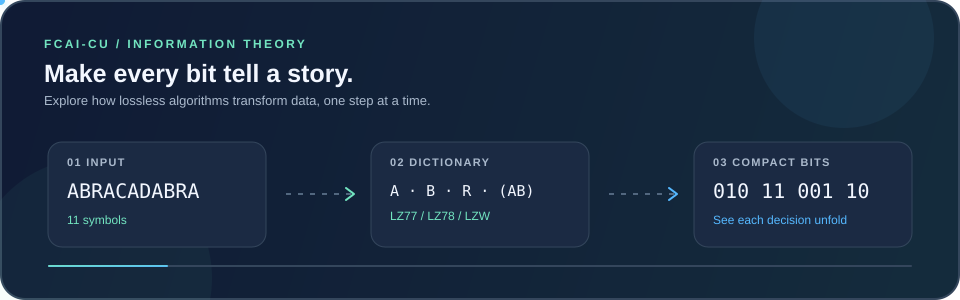

<p align="center">
  
</p>

<h1 align="center">FCAI-CU Visualizer</h1>

<p align="center">
  Interactive learning for algorithms, data structures, information theory, and data compression.
</p>

<p align="center">
  
</p>

<p align="center">
  <a href="https://github.com/Yosef-Ibrahim/FCAI-Visualizer/actions">CI</a>
  · React 19
  · Vite 8
  · JavaScript
</p>

## About

FCAI-CU Visualizer is an educational web application for students of the Faculty
of Computers and Artificial Intelligence at Cairo University. It turns
algorithms and data structures into interactive lessons: inspect each step,
control playback, and experiment with input values.

The interface supports English, Arabic, Japanese, and Chinese, with light and
dark themes.

## Courses and features

### Data Structures

- Arrays, stacks, queues, and linked lists.
- Sorting algorithms: bubble, selection, insertion, merge, quick, heap,
  counting, and radix sort.
- Searching algorithms: linear, binary, and jump search.
- Graphs, including BFS, DFS, Dijkstra, Prim, and Kruskal.

### Advanced Data Structures

- Binary search trees and tree traversals.
- AVL trees with balancing rotations.
- Red-black trees with insertion balancing and node colors.

### Information Theory and Data Compression

The lossless-compression lessons provide independent compression and
decompression, step-by-step explanations, and slow, normal, and fast playback:

- **LZ77** — sliding search and look-ahead windows; enter tags directly to
  decompress without first running compression.
- **LZ78** — phrase dictionary and index/next-symbol tags.
- **LZW** — ASCII dictionary codes, including the lecture's worked example.
- **Huffman coding** — static prefix codes and the lecture's modified
  “Others” technique.
- **Adaptive Huffman** — an evolving tree with its current paths, node weights,
  and node numbers visualized during playback.
- **Arithmetic coding** — interval encoding and decoding with configurable
  symbol frequencies.

Lossy-compression methods are identified as planned rather than presented as
implemented visualizers.

### Learning tools

- Practice Mode for interactive algorithm questions.
- Compare Mode for tracing two algorithms side by side.

## Technology

- React 19 and React Router 7.
- Vite 8.
- JavaScript and JSX (no TypeScript application source).
- Tailwind CSS 4 is configured; existing pages also use the project's
  CSS-variable design system.
- Canvas 2D visualizers for applicable algorithms and data structures.
- i18next for localized interface text.
- Vercel Analytics and Vercel deployment configuration.

Algorithm implementations are kept separate from React page components where
possible. Pages coordinate input, playback, and rendering; reusable engines
produce the algorithm state and steps.

## Requirements

- Node.js 24.x (the pinned version is specified in `.node-version`).
- npm.

### Windows: optional project-local Node.js

You can use the included portable Node setup instead of installing Node
globally. From the repository root, run PowerShell:

```powershell
powershell -ExecutionPolicy Bypass -File .\scripts\setup-node.ps1
.\npm.cmd install
.\npm.cmd run dev
```

The setup downloads the pinned official runtime, verifies its SHA-256 checksum,
and stores it under the ignored `.tools/` directory. Use `.\npm.cmd` for project
commands when using this runtime. The setup does not change the system Node
installation or persistent `PATH`. Run setup again if `.node-version` changes.

On macOS and Linux, use an existing Node.js 24.x installation or a user-local
version manager.

## Getting started

```bash
git clone https://github.com/Yosef-Ibrahim/FCAI-Visualizer.git
cd FCAI-Visualizer
npm install
npm run dev
```

The development server prints its local URL after it starts.

## Useful commands

```bash
npm run dev         # Start the Vite development server
npm run lint        # Run ESLint
npm run typecheck   # Run the configured TypeScript checker
npm run i18n:check  # Check that locale catalogs are in sync
npm run build       # Create the production build in dist/
npm run preview     # Preview the production build locally
npm run verify      # Run lint, typecheck, i18n checks, and build
```

There is currently no automated test-runner script. Algorithm examples and
round trips can be verified with the project’s available checks and by
exercising the relevant visualizer in the browser.

## Deployment

The project is configured for Vercel. Connect the GitHub repository to Vercel
and deploy with the default Vite build settings, or verify a production build
locally:

```bash
npm run build
```

Vercel serves the app as a single-page application; route rewrites are configured
in `vercel.json`.

## Contributing

- Keep algorithm logic in the framework-independent algorithm or application
  layers; React pages should coordinate the visualization and playback.
- When adding user-facing text, update all four locale catalogs and run
  `npm run i18n:check`.
- Preserve accessible labels and narration for interactive visualizations.
- Run `npm run verify` before submitting changes when possible.
- Follow the repository conventions in [`AGENTS.md`](AGENTS.md).

## License

This project is distributed under the GNU Affero General Public License v3.0.
See [`LICENSE`](LICENSE) for the full license text.
